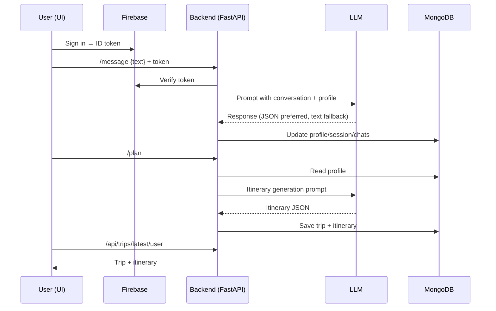
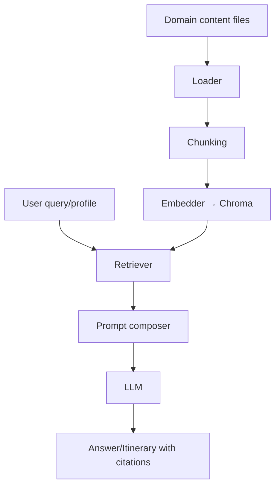
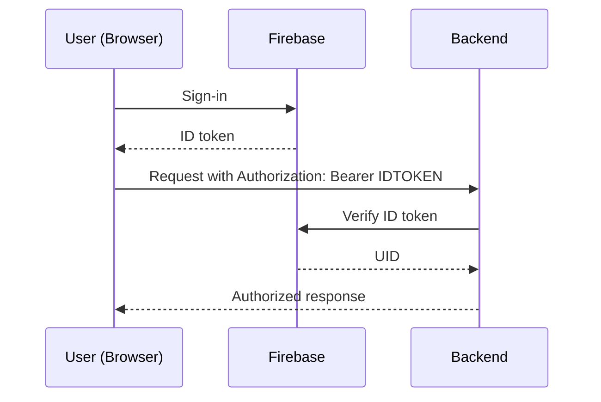

# WanderMind AI — Architecture Guide

This document provides a deep technical guide to WanderMind AI: system design, modules, workflows, data schemas, APIs, advanced implementation details, known limitations, and pragmatic recommendations. It complements the project README with deeper engineering context for contributors and maintainers.

---

## 1. Quick Start

- Prerequisites:
  - Python 3.9+
  - Node.js 18+
  - MongoDB running locally or remote
  - OpenAI API key (`OPENAI_API_KEY`)
  - Firebase credentials (`firebase-admin` for server, web config for client)
- Setup:
  1. Create `.env` (backend):
     - `OPENAI_API_KEY=...`
     - `MONGO_URI=mongodb://localhost:27017`
     - `MONGO_DB=wandermind`
     - `FIREBASE_SERVICE_ACCOUNT_PATH=auth/serviceAccount.json`
  2. Create `.env` (frontend via Vite):
     - `VITE_API_BASE=http://127.0.0.1:8000`
     - `VITE_FIREBASE_...` (web config vars)
- Run:
  - Backend:
    ```powershell
    uvicorn app:app --reload
    ```
  - Frontend:
    ```powershell
    npm install
    npm run dev
    ```
- Health checks:
  - Open `http://127.0.0.1:5173/` (UI)
  - Test `http://127.0.0.1:8000/docs` (FastAPI Swagger)

---

## 2. Project Overview

- Purpose: AI-assisted travel planning with chat-guided data collection, generated itineraries, booking links, and location-aware contexts via RAG.
- Architecture style: Modular FastAPI backend + Vite vanilla JS frontend; MongoDB for state; ChromaDB for embeddings; Firebase-authenticated sessions.
- High-level data flow:
  - User logs in via Firebase → UI calls backend with ID token → backend verifies → chat workflow collects trip profile → `/plan` generates itinerary → saved in MongoDB → UI fetches latest trip and renders itinerary + booking links.

---

## 3. Module Deep-Dive

- Backend root
  - `app.py`: FastAPI app, routes and orchestration for chat, planning, trips, booking links, profile updates, and sync actions.
  - `requirements.txt`: Core dependencies including FastAPI, PyMongo, httpx, Chroma, LangChain/OpenAI, Firebase admin.
  - `docker-compose.yml` & `Dockerfile`: Containerization and dev composition.

- Core AI & RAG (`core/`)
  - `llm.py`: LLM client abstraction (OpenAI primary; Gemini legacy). Handles timeouts, JSON parsing attempts, graceful fallback to text.
  - `prompts.py` and `prompts/`: Prompt templates for chat turns, itinerary generation, and extraction.
  - `extract.py`: Helpers to coerce/validate model outputs into structured fields. JSON-first parsing, then text fallbacks.

- Data & DB (`db/`)
  - `mongo.py`: Connection, collections, CRUD. Collections: `users`, `sessions`, `chats`, `trips`, `itineraries`. Upserts and composite keys (`user_id_session_id`) where relevant.

- Routes/API (`routes/`)
  - `travel.py`, `booking.py`, `trips.py` and variants: Specialized endpoints for search, booking link generation, and trip synchronization.
  - `accommodations.py`: Accommodation-related endpoints or utilities (if used).

- Frontend (`Land/`)
  - `landingpage.html`, `Main/`, `itinerary/`, `js/`: UI pages and scripts for itinerary display, map integration, session management, and booking links.
  - `firebase-init.js`: Web SDK config for Firebase client auth.

- RAG Pipeline (`src/`)
  - `loader.py`, `chunking.py`: Load travel content, chunk by rules.
  - `embedder.py`: Create embeddings to ChromaDB.
  - `retriever.py`: Query similar content for prompts.
  - `rag.py`: Ties retriever outputs into prompts and LLM calls.

- Utilities (`utils/`)
  - `geocoding.py`: Nominatim-based forward/reverse geocoding with timeouts and error handling.
  - `helpers.py`: Shared helpers for string/date/URL building and safe parsing.

---

## 4. Core Workflows

### Trip Planning Conversation



### RAG Content Augmentation



### Auth & Session



---

## 5. Database Schema

- MongoDB Collections
  - `users`: `{ uid, email, created_at, prefs }`
  - `sessions`: `{ session_id, uid, created_at, status }`
  - `chats`: `{ uid, session_id, role, content, ts }`
  - `trips`: `{ trip_id, uid, title, profile, days, created_at }`
  - `itineraries`: `{ uid, session_id, trip_id, items[], geo[], saved_at }`

- ChromaDB
  - Collections per country or topic under `chroma_db/` and `chroma_persist/`.
  - Metadata includes city/region/category; ids map to content sources.

- Indices & Keys
  - Index chats by `uid + session_id + ts`.
  - Index trips by `uid + created_at` for latest retrieval.
  - Maintain consistent `trip_id` between `trips` and `itineraries` when synced.

---

## 6. API Reference (Summary)

- Auth: Firebase ID token in `Authorization: Bearer <token>`.
- Key endpoints (see `app.py` and `routes/` for exact signatures):
  - `POST /message`: Chat turn; accepts user text; updates profile; returns assistant reply.
  - `POST /plan`: Generates itinerary based on collected profile; saves to `trips` + `itineraries`.
  - `GET /chats`: List user chats and sessions.
  - `GET /chat/{session_id}`: Retrieve chat history for a session.
  - `DELETE /chat/{session_id}`: Delete chat/session data.
  - `POST /chat/title` and `/chat/update-title`: Title utilities.
  - `GET /api/trips/latest/user`: Latest trip for user.
  - `GET /api/trips/{trip_id}`: Get specific trip details.
  - `POST /trips/itinerary/save`: Persist itinerary items with geocodes.
  - `POST /trips/sync-itinerary-to-trip`: Sync items into trip document.
  - `POST /travel/search`: Travel-related searches.
  - `POST /travel/booking-links`: Build booking links (flights/hotels/activities).

---

## 7. Advanced Topics

- RAG Implementation
  - Content ingestion (`src/loader.py`), chunking (`src/chunking.py`), embedding (`src/embedder.py`), retrieval (`src/retriever.py`), and response synthesis (`src/rag.py`).
  - Prompt composer enriches LLM context with retrieved passages and structured profile.

- Prompt Engineering Patterns
  - JSON-first outputs with schema hints; if parsing fails, fallback to robust text extraction.
  - Chain-of-thought hidden; ask for explicit fields only.

- Async & Reliability
  - Use `httpx` with timeouts for geocoding and external APIs.
  - Backoff/retry for Nominatim; cache reverse geocodes for known coordinates.

- Caching & Rate Limits
  - Basic memoization for reverse geocode (city by coordinates).
  - Consider an intermediate cache (Redis) for hot queries.

---

## 8. Gotchas & Limitations

- Nominatim timeouts
  - Observed `Read timed out (read timeout=5)` in logs; add retries, longer timeout, or fallback to coarse locations.
- LLM JSON variability
  - Many replies are non-JSON; keep tolerant parser + text fallbacks; encourage strict JSON in prompts.
- Flight URL omissions
  - When origin is missing or equals destination, flight links are omitted; ensure origin is a city string, not only coordinates.
- OneDrive + WatchFiles
  - File watcher restarts and `KeyboardInterrupt` noise when auto-reloading on Windows/OneDrive; consider disabling `--reload` in production, or move workspace outside synced folders.

---

## 9. External API Integrations

- OpenAI API: Primary model for chat and itinerary generation; environment variables required.
- Firebase Admin + Web SDK: Auth verification server-side and sign-in client-side.
- Nominatim (OpenStreetMap): Forward and reverse geocoding; respect usage policy and rate limits.
- MongoDB: Primary persistence for users, sessions, chats, trips, itineraries.
- ChromaDB: Embedding store for domain content powering RAG.
- Optional: AviationStack or other travel APIs can be plugged into `routes/travel.py`.

---

## 10. Recommendations

- Security
  - Validate Firebase tokens on each request; avoid trusting client fields.
  - Store API keys in `.env` and avoid committing secrets.

- Testing
  - Unit tests for JSON parsers and itinerary structuring.
  - Integration tests for `/message`, `/plan`, `/api/trips/latest/user`.

- Deployment
  - Use Docker Compose with separate services for backend, frontend, MongoDB, and a ChromaDB container.
  - Configure `uvicorn` without `--reload`; enable structured logs.

- Performance
  - Add server-side caching for geocoding.
  - Batch geocoding calls during `/plan`.

- Observability
  - Centralize logs; add request IDs; track LLM latency and parse failures.

- Future Work
  - Strict schema validation with Pydantic models across endpoints.
  - Replace ad-hoc text fallbacks with robust extraction against a JSON schema.
  - Consider managed vector DB (e.g., Pinecone) if ChromaDB scaling becomes a concern.
